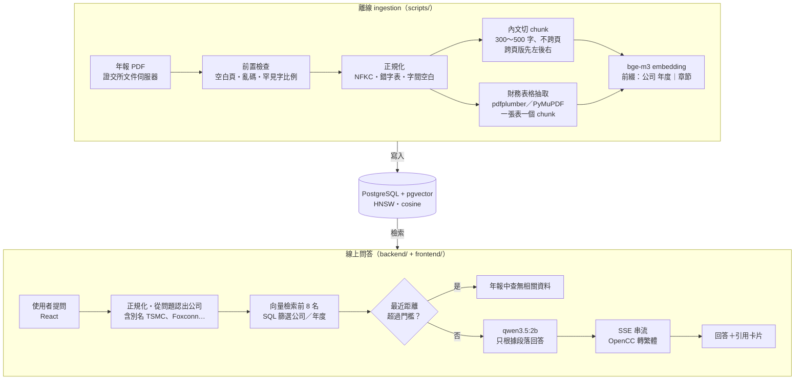

# twse-report-rag

[](https://github.com/kimi0217/twse-report-rag/actions/workflows/ci.yml)

**台灣上市公司年報 AI 問答助理：用中文提問，系統從年報 PDF 找出相關段落和財務表格，逐字回答，並附上可以點開驗證的出處。**

> A local RAG assistant that answers Chinese questions about Taiwanese companies' annual reports, with clickable citations to the source page.
> It runs entirely on your machine — Ollama (bge-m3 + qwen3.5:2b), PostgreSQL/pgvector and hand-written retrieval, no LangChain and no API keys — and starts with `docker compose up`.
> On a 26-question evaluation set drafted from the report text (each with quoted evidence, spot-checked by hand), retrieval found the right page for all 22 answerable questions (hit@8 22/22) and answer accuracy rose from 69% to 81%; most remaining errors come from the small model misreading the retrieved text.


目前收錄 5 家公司的 2025 年度（民國 114 年度）股東會年報：台達電 2308、鴻海 2317、台積電 2330、廣達 2382、聯發科 2454。

年報被切成 1,794 個 **chunk**，其中內文 1,779 段、財務表格 15 張。

## 功能

- **出處可以點開驗證**：回答裡的 `[1]` 可以點，畫面會捲到對應的引用卡片。卡片寫著公司、年度和 PDF 頁碼，點開能看完整原文，表格會顯示成真正的表格。卡片上的公司和頁碼由程式直接提供，不讓模型自己寫，所以不會出現編造的頁碼。
- **財務表格保留原本的結構**：一張表存成一個 chunk，不會被切開，數字和年份才不會對錯。年報裡有「合併報表」（整個集團）和「個體報表」（只有母公司），兩張表長得很像，程式會在表名前標明是哪一種，並寫上金額單位。表格範圍內的文字不會再當成一般內文重複存一次，避免數字黏在一起誤導模型。
- **找不到就說找不到**：用兩層把關。第一層由程式判斷：問題跟年報內容差太遠，就直接回答「年報中查無相關資料」，不呼叫模型。第二層由模型判斷：prompt 規定只能根據找到的段落回答。評估中，問到資料庫沒有的公司或無關的問題，全部正確拒答（主評估集 4/4、held-out 3/3）。
- **完全在本機執行、免費**：embedding、LLM和資料庫都在自己的電腦上跑，不需要 API key，也沒有費用。下載 10 MB 的資料庫 seed，再執行 `docker compose up` 就能使用。
- **用數據說明效果**：準備了一組評估題目，每次修改都量出前後差異；另外有一組改進前就鎖定的 held-out 題目，用來做最後驗收（見[評估結果](#評估結果)）。

## 架構



系統分成兩半：
- **離線 ingestion**：把年報處理好、存進資料庫，只需要跑一次。
- **線上問答**：每次有人提問時執行，只讀取資料庫。網站沒有上傳檔案的功能。

## 快速開始

使用預先處理好的資料庫內容（**seed**），不需要自己下載 PDF，也不需要跑 ingestion。

### 需要先安裝

- **Docker**：[Docker Desktop](https://www.docker.com/products/docker-desktop/) 或 [OrbStack](https://orbstack.dev/)（Mac），裝好後要先開啟。
- **Ollama**：[ollama.com/download](https://ollama.com/download)，請安裝最新版，舊版下載不了 `qwen3.5:2b`。Ollama 要直接裝在電腦上，不放進 Docker，因為 Mac 上的 Docker 用不到 GPU，模型會很慢。
- `git`、`curl`：macOS 內建。

### 步驟

```bash
git clone https://github.com/kimi0217/twse-report-rag.git
cd twse-report-rag

# 1. 下載模型（embedding 約 1.2 GB、LLM 約 3 GB）
ollama pull bge-m3
ollama pull qwen3.5:2b

# 2. 設定檔（預設值即可直接使用）
cp .env.example .env

# 3. 下載資料庫 seed（約 10 MB，會檢查 SHA-256）
sh scripts/fetch_seed.sh

# 4. 啟動 db、backend、frontend
docker compose up -d --build
```

打開 <http://localhost:8080>，點範例問題，或直接輸入問題。

- **第一次建置**：會先下載 Python、Node、nginx 的基礎 image，約 300 MB。之後重新建置只要幾十秒。
- **第一次啟動**：資料庫會自動匯入 seed，約 1～2 分鐘。匯入完成前，backend 不會啟動。可以用 `docker compose ps` 確認三個服務都是 running（db、backend 會顯示 healthy）。
- **第一次提問**：Ollama 要先把模型載入記憶體，約 15 秒；之後每題約 5～15 秒。
- **後端 API**：<http://localhost:8000>（例如 `curl localhost:8000/companies`）。

<details>
<summary>常見問題</summary>

- **網頁顯示「無法連線到後端服務」**：backend 還在等資料庫匯入 seed，稍等一下再重新整理；或用 `docker compose logs backend` 查看錯誤。
- **回答「回答時發生錯誤」，訊息提到連線失敗**：電腦上的 Ollama 沒有在執行。打開 Ollama app，或執行 `ollama serve`。
- **還沒下載 seed 就先執行了 `docker compose up`**：資料庫只會在第一次啟動時匯入 seed，要把資料刪掉重來：

  ```bash
  docker compose down -v
  sh scripts/fetch_seed.sh
  docker compose up -d
  ```

- **port 被其他程式占用**：在 `.env` 修改 `FRONTEND_PORT`（預設 8080）、`BACKEND_PORT`（8000）、`DB_PORT`（5433）。
- **停止服務**：`docker compose down`（資料會保留）；`docker compose down -v` 會連資料庫一起刪除。

</details>

## 評估結果

完整報告：[`eval/results.md`](eval/results.md)；題目與原文證據：[`eval/questions_review.md`](eval/questions_review.md)。

### 評估題目

**主評估集共 26 題**，由 Claude Code 讀年報原文出題，每題附上原文擷取的證據和頁碼，經人工抽查。題目用一般使用者的口吻提問，避免跟原文字句太像而讓分數虛高。

| 題型 | 題數 | 例子 |
|---|---|---|
| 數字題 | 11 | 台積電 2025 年合併營業收入是多少？ |
| 文字題 | 8 | 聯發科的董事長是誰？ |
| 別名題 | 2 | 用英文名稱提問，例如「TSMC」「Foxconn」 |
| 跨公司比較 | 1 | 台積電和聯發科去年各花了多少錢在研發？ |
| 拒答題 | 4 | 問資料庫沒有的公司，或跟年報無關的問題 |

前 4 類共 22 題是「可以回答的題目」，用來計算檢索指標；拒答題用來檢查系統會不會亂答。

其中 7 題在開發過程中就被拿來測試、調整過，標成 `seen`。這些題目可能因為被調整過而答得比較好，所以另外列出排除它們之後（剩 19 題）的分數。

### 指標說明

- **hit@k**：正確答案所在的頁面，有沒有出現在檢索結果的前 k 名。例如 hit@8 就是「交給模型的 8 段資料裡，有沒有包含答案」。
- **MRR**：正確答案平均排在第幾名的指標，介於 0～1，越接近 1 代表正確答案排得越前面。
- **誤拒率**：能回答的題目，卻被系統回答「查無資料」的比例。
- **回答正確率**：回答裡同時寫出正確數字和正確單位才算對（文字題要包含所有關鍵字）。

### 逐步改進（主評估集 26 題）

| 版本 | hit@3 | hit@8 | MRR | 誤拒率 | 回答正確率（全部 26 題） | 回答正確率（排除開發時用過的 7 題，共 19 題） |
|---|---|---|---|---|---|---|
| baseline（純向量檢索） | 91%（20/22） | 100%（22/22） | 0.78 | 23%（5/22） | 69%（18/26） | 63%（12/19） |
| + 改進 1：問題提到已知公司時，放寬拒答門檻 | 91% | 100% | 0.78 | **5%（1/22）** | **81%（21/26）** | 74%（14/19） |
| + 改進 2：a 提示模型年度 + b 依相似度排序段落 | 91% | 100% | 0.78 | 5% | 69% ⬇ | 68% |
| + 改進 1 + 2b（撤回 2a） | 91% | 100% | 0.78 | 5% | 81% | 74% |
| **最終：+ 改進 1 + 2b + 輸出長度上限** | 91% | 100% | 0.78 | 5% | **88%（23/26）** | **84%（16/19）** |

- 檢索指標（hit@k、MRR、誤拒率）只算 22 題可回答題；回答正確率算全部 26 題。
- 每個版本的 4 題拒答題都正確拒答（4/4）。
- **改進 2a 反而變差，已撤回**：在 prompt 寫明「去年指 2025 年」後，修好了 2 題，卻讓另外 4 題的模型把「去年」理解成民國 113 年，讀錯欄位，正確率從 81% 掉回 69%。
- **81% → 88% 不算是改善**：多答對的 2 題跟輸出長度上限無關，而是模型每次回答都會有些不同（temperature 0.1）造成的。同樣的設定重跑，結果可能差 1～2 題。
- **兩欄回答正確率的差別**：排除開發時用過的 7 題後，分數一直低 5～7 個百分點，符合「用過的題目答得比較好」的預期；但改進的趨勢一樣，代表改進不是只對那 7 題有效。

### Held-out 驗收（6 題）

**held-out** 是另外準備的 6 題，在開始改進系統之前就寫好、鎖定，之後不准修改，只在最後測一次。改進是看著主評估集的失敗題目設計的，可能只對那 26 題有效；held-out 是改進時完全沒看過的題目，最能反映系統真正的實力。

| 項目 | 結果 |
|---|---|
| 檢索（3 題可回答題） | hit@3 3/3、hit@8 3/3 |
| 拒答（3 題提到已知公司、但年報裡沒有答案，例如「台積電明年股價」） | 3/3 正確拒答，但都是模型判斷的，第一層的程式門檻一題都沒擋下 |
| 回答正確率 | 自動判分 4/6；**人工複核 3/6** |

- 人工複核改判 1 題：h03 的答案用了前一年度的數字，只是順帶提到了正確數字；自動判分只檢查「有沒有包含」正確答案，所以誤判成對的。照規定，驗收後不修改判分規則，只在報告裡註記。
- 第一次驗收時，有一題的回答一直生成停不下來，跑了 21 分鐘只好中止。加上輸出長度上限之後，重跑了一次（見下方「遇到的問題」第 7 點）。

### 結論

**檢索已經達到要求**：22 題可回答題的正確頁面全部都在前 8 名（hit@8 22/22），held-out 的 3 題也一樣（3/3）。

**問題出在 2B 小模型的閱讀理解**：主評估集和 held-out 答錯的題目，大多是正確段落已經交給模型了，模型卻讀錯欄位（把「去年」讀成前一年度）、挑錯人名，或明明有答案卻回答查無資料。所以下一步最有效的是換成更大的 LLM，或由程式先把「去年」換成明確的年度，而不是繼續調整檢索。

## 測試

- **pytest 110 個**：涵蓋 PDF 前置檢查、表格抽取、chunk 切分、ingestion、後端 API、評估判分等。其中 6 個是資料庫整合測試，會連真正的 pgvector。embedding 和 LLM 一律用假的替身（fake），不需要 Ollama。
- **Vitest 17 個**：測試前端的 SSE 解析（一個事件或一個中文字被網路切成兩塊時，能否正確拼回）、回答裡 `[n]` 引用編號的拆解，以及引用卡片要顯示哪幾張的規則。
- **CI 自動執行**：每次 push 和 pull request 時，[GitHub Actions](.github/workflows/ci.yml) 會自動跑 pytest（連真的 pgvector；連不上資料庫就判定失敗，不會悄悄跳過）、前端的 eslint、Vitest 和 build，以及兩個 Docker image 的建置。
- **測試環境**：在 macOS 上開發與測試，CI 在 Linux（Ubuntu）上執行；Windows 沒有測試過。

## 遇到的問題與解法

詳細過程見 [`docs/pdf-preflight.md`](docs/pdf-preflight.md)、[`docs/known-issues.md`](docs/known-issues.md)。

1. **抽得出中文，但字是錯的**
   - 問題：中華電年報的字型對照表壞掉，「聯合國企業與人權指導原則」被抽成「耡合國企噟和人奙䭷㼫原則」。
   - 怎麼發現：抽查時看到奇怪的字。原本的三個檢查指標都沒抓到，因為這些錯字都是合法的中文字，不算亂碼。
   - 解法：新增「罕見字比例」指標，計算不在 Big5 常用字範圍內的字佔多少比例，超過 2% 就判定不能用。中華電因此被換成廣達。
   - 數字：中華電全文 **14.65%**，其他 4 家只有 **0.02%～0.06%**（後來補進的廣達是 0.10%，因為人名用字較多）。
2. **肉眼看起來一樣、但電腦認為不同的字**
   - 問題：部分 PDF 把「金」「長」存成康熙部首等特殊字碼（例如 ⾦ U+2FA6），看起來一樣，但搜尋「金」會找不到，embedding 也會不準。
   - 解法：所有 PDF 文字和使用者的問題，一律先做 **NFKC 正規化**，把這類字統一成標準字。個別 PDF 特有的錯字，另外用 `data/char_fixes.json` 依檔名修正。
   - 數字：中華電全文有 1,157 個，台積電有 12 個。
3. **跨頁版 PDF 讀錯順序、抓錯表名**
   - 問題：台積電的年報一個 PDF 頁面放了左右兩頁，整頁讀取會讓兩欄文字交錯在一起；找表名時也會抓到隔壁那張表的名字，讓個體報表被標成合併報表。
   - 解法：頁面寬度大於高度時，先切成左右兩半，各自讀取，先左後右；表名只在表格自己的左右範圍內找，再補上「合併」或「個體」。
   - 數字：台積電年報 92 個 PDF 頁面中，有 90 頁是跨頁版。評估中「台積電合併營收」和「台積電集團資產總額」兩題的正確表格，都排在檢索結果第 1 名。
4. **表格被攤平成黏在一起的數字**
   - 問題：PDF 裡的表格如果當成一般文字讀，會變成「38,000,0003,363,008…」這種分不出邊界的數字串，檢索時還會排在真正的表格前面，讓模型讀錯。另外，用 pdfplumber 抽台積電的表格時，項目欄整欄是空的。
   - 解法：項目欄大多空白的表格，改用 PyMuPDF 重新抽取；只保留項目欄有財務項目的表格；存內文時，跳過已經抽成表格的範圍。
   - 數字：一開始抽出 41 張表，其中 7 張是把一般內文誤認成表格；修正後是 15 張，誤認 0 張。沒被抽成表格的非財務表格，仍會以攤平的形式留在內文裡，列為已知限制。
5. **金額單位差了 1,000 倍**
   - 問題：模型把「新台幣 3,809,054,272 仟元」回答成「3,809,054,272 元」，少了「仟」字，金額就差了一千倍。
   - 怎麼發現：後端完成後，實際測試台積電營收這題時發現。
   - 解法：表格段落開頭多加一行「金額單位：新台幣仟元」；prompt 裡放上不能省略「仟」的例子；評估的判分規則也要求數字和單位都要正確。
6. **拒答門檻把能回答的問題擋掉了**
   - 問題：拒答門檻 0.33 是用一些簡短、用中文公司名的問題訂出來的。用英文公司名提問的題目，以及同時問兩家公司的題目，跟資料的距離本來就比較遠（0.34～0.49），結果被誤判成「查無資料」。
   - 怎麼發現：第一次評估時，誤拒率高達 23%（5/22）。
   - 解法：問題裡認出資料庫有的公司時，檢索本來就已經限定在那家公司，所以門檻可以放寬到 0.5。
   - 數字：誤拒率 **23% → 5%**（5/22 → 1/22），回答正確率 69% → 81%。
7. **模型回答停不下來**
   - 問題：held-out 驗收時，有一題的回答生成了 21 分鐘都沒停。原本設定的 120 秒逾時，是指「等待下一段資料」的時間，只要模型一直有輸出，就永遠不會觸發。
   - 解法：限制模型最多輸出 1,024 個 token（`num_predict=1024`；主評估集正常回答最長約 460 個 token，留了約 2 倍空間）；每次提問最多 60 秒，超過就在回答結尾加上「（回答過長，已截斷）」；評估程式改成每做完一題就存結果，單題逾時就記為失敗、繼續下一題。
8. **資料庫還在匯入資料，就被判定為準備好了**
   - 問題：資料庫第一次啟動匯入 seed 時，會先開一個暫時的伺服器，它只接受電腦內部的特殊連線方式（Unix socket）。健康檢查剛好用這種方式連，就誤以為資料庫已經準備好，backend 太早啟動，使用者一提問就失敗。
   - 怎麼發現：在乾淨的環境模擬新使用者第一次啟動時發現。
   - 解法：健康檢查（healthcheck）改用一般的網路連線（TCP，`-h 127.0.0.1`）來檢查；另外讓後端每次使用資料庫連線前先確認連線還有效，資料庫重新啟動後也不會出錯。

## 技術選型與理由

| 項目 | 選擇 | 理由 |
|---|---|---|
| 執行環境 | 完全在本機 | 不需要 API key、沒有費用，別人 clone 下來就能重現結果。代價是只能用小模型，評估結果也證實瓶頸就在這裡。 |
| Embedding | Ollama `bge-m3`（1024 維） | 支援多國語言，中文效果好。1024 維在 pgvector HNSW 索引的 2,000 維上限以內。 |
| LLM | Ollama `qwen3.5:2b`，關閉思考模式 | 筆電跑得動的最小可用模型。開啟思考模式實測一題要約 150 秒，關掉約 7 秒，即時問答一定要關。 |
| 向量資料庫 | PostgreSQL + pgvector | 向量和公司、年度、頁碼存在同一張表，篩選公司直接寫在 SQL 裡。只篩一家公司時，用 HNSW 的 `iterative_scan` 確保還是能找滿 8 筆。 |
| RAG 框架 | 不用 LangChain / LlamaIndex | chunk 切分、檢索、prompt 組裝都自己寫：每個設計決策都說得出理由，也能用評估量出效果，需要的套件也比較少。 |
| 前端 | React + Vite + TypeScript + Tailwind | SSE 解析和引用連結都自己寫，不用額外的 UI 或 markdown 套件。 |

## 已知限制與未來方向

詳見 [`docs/known-issues.md`](docs/known-issues.md)，重點如下：

- **小模型會把「去年」讀成前一年度**：在 prompt 加提示的做法試過了，反而變差，已撤回。未來改由程式先把「去年」換成明確的年度。
- **回答裡的引用編號 `[n]` 可能指錯段落**：引用卡片的公司和頁碼由程式提供，一定正確；但回答文字裡的 `[n]` 是模型自己寫的，可能標錯。
- **判分規則只檢查回答「有沒有包含」正確答案**：像 held-out 的 h03 那樣順帶提到正確數字也會被判對，所以回答正確率可能略為偏高。
- **沒被抽成表格的非財務表格**（例如股本形成經過）仍以攤平的數字串留在內文 chunk 裡，偶爾會排進檢索前幾名。
- **評估題目不多**：主評估集 26 題、held-out 6 題。22 題可回答題中，1 題就約等於 4.5%，小幅差異不宜過度解讀。

## 從原始資料重建

<details>
<summary>展開步驟：從證交所下載 PDF，自己跑一次完整的資料處理流程</summary>

不使用 seed，從證交所下載年報 PDF，自己跑一次完整流程：前置檢查 → 抽財務表格 → 切 chunk、算 embedding、寫入資料庫。資料處理的程式在電腦上的 Python 虛擬環境（venv）裡執行，資料會寫進 docker compose 啟動的資料庫。

需要 Python 3.11 以上，以及「快速開始」裡的 Docker、Ollama 和 `bge-m3` 模型。

```bash
# 1. Python 環境
python3 -m venv .venv
source .venv/bin/activate
pip install -r requirements-ingest.txt

# 2. 啟動資料庫，並把 .env 的設定載入目前的 shell（腳本從環境變數讀設定）
cp -n .env.example .env
docker compose up -d db
set -a; . ./.env; set +a

# 3. 從證交所文件伺服器下載 5 家公司的 2025 年報到 data/pdfs/（約 24 MB）
python scripts/download_reports.py

# 4. 前置檢查：確認 PDF 抽得出正確的中文（結果在 reports/）
python scripts/check_pdf_text.py data/pdfs/

# 5. 抽財務表格到 data/tables/（.md 給人看、.jsonl 給 ingestion）
python scripts/extract_financial_tables.py data/pdfs/

# 6. 切 chunk、算 embedding、寫入資料庫（第一次約 4～5 分鐘；embedding 會快取，重跑很快）
python scripts/ingest.py data/pdfs/

# 7. 啟動 backend 與 frontend
docker compose up -d --build
```

- 證交所的檔案跟各公司官網上的年報是同一份（已用 SHA-256 比對過），所以頁碼和評估題目對得上。
- 證交所下載失敗時，可以到[公開資訊觀測站](https://mops.twse.com.tw/)手動下載中文版股東會年報，存成 `data/pdfs/<股票代號>_2025.pdf`。
- ingestion 可以重複執行：同一家公司、同一年度的舊資料會先刪除再寫入，不會重複。
- 資料處理的判斷標準和遇到的問題，見 [`docs/pdf-preflight.md`](docs/pdf-preflight.md)。

</details>

## 開發方式

使用 [Claude Code](https://claude.com/claude-code) 協助實作；架構設計、資料品質判斷和評估方法由我主導。開發時給 Claude Code 的指引（目標、資料模型、開發規則和工作方式）見 [`CLAUDE.md`](CLAUDE.md)。

## 資料來源

年報 PDF 來自[臺灣證券交易所](https://www.twse.com.tw/)文件伺服器（doc.twse.com.tw）和[公開資訊觀測站](https://mops.twse.com.tw/)，是各公司依法公開的 2025 年度股東會年報，著作權屬於各公司。

本專案只作為技術展示和學習用途：repo 裡不含 PDF；GitHub Release 上的資料庫 seed 包含從年報抽出的文字和表格，只用來重現問答結果。回答內容由 AI 產生，可能有錯，不構成投資建議，請以原始年報為準。