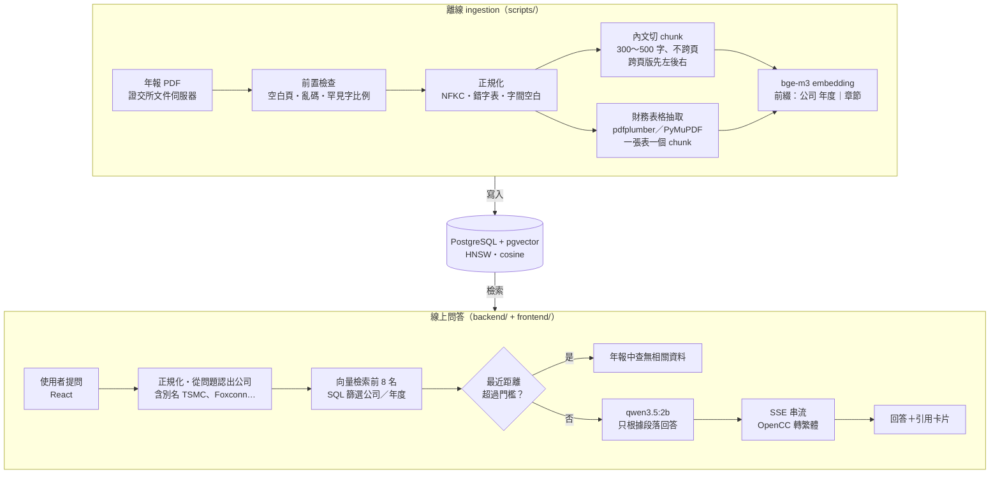

# twse-report-rag

[](https://github.com/kimi0217/twse-report-rag/actions/workflows/ci.yml)

**台灣上市公司年報 AI 問答助理。使用者用中文問台灣上市公司年報的問題，系統從年報裡找出相關的段落和財務表格，交給語言模型整理成回答，並附上引用，點開即可看到原文。**

> A local RAG assistant that answers Chinese questions about Taiwanese companies' annual reports, with clickable citations to the source page.
> It runs entirely on your machine — Ollama (bge-m3 + qwen3.5:2b), PostgreSQL/pgvector and hand-written retrieval, no LangChain and no API keys — and starts with `docker compose up`.
> On a 26-question evaluation set, retrieval found the right page for all 22 answerable questions (hit@8 22/22), and answer accuracy rose from 69% to 81%; most remaining errors come from the small model misreading the retrieved text.


收錄 5 家公司的 2025 年度股東會年報：台達電（2308）、鴻海（2317）、台積電（2330）、廣達（2382）、聯發科（2454）。年報被切成 1,794 個 chunk（切好的小段落），其中內文 1,779 個、財務表格 15 個。

## 功能

- **引用可以點開驗證**：回答裡的 `[1]` 可以點，會捲動到對應的來源卡片；卡片列出公司、年度、PDF 頁碼，點開可以看完整原文。來源清單由程式組成，不靠模型自己標。
- **財務表格保留結構**：財務表格一張表存成一個 chunk，不切開；年報裡有「合併報表」（整個集團）和「個體報表」（只有母公司），兩張表長得很像，程式會在表名前標明是哪一種，並寫上金額單位。表格範圍內的文字不會再當成一般內文重複存一次，避免數字黏在一起誤導模型。
- **找不到就說找不到**：兩層拒答。程式層先看檢索距離，太遠就直接回答「年報中查無相關資料」、不呼叫 LLM；prompt 再要求模型只能根據段落回答。資料庫外的公司與無關問題在評估中 100% 拒答。
- **完全本機、免費**：embedding、LLM、資料庫都在自己的電腦上執行，沒有 API key 與費用；`docker compose up` 加上 10 MB 的資料庫 seed 就能使用。
- **用數據說話**：手工出題的評估集與凍結的 held-out 驗收集，每次改動都量化前後差異（見[評估結果](#評估結果)）。

## 架構



離線流程只跑一次，把資料寫進資料庫；線上服務只讀資料庫，網站沒有上傳功能。

## 快速開始

使用預先建好的資料庫（seed），不需要 PDF，也不需要跑 ingestion。

### 需要先安裝

- **Docker**：[Docker Desktop](https://www.docker.com/products/docker-desktop/) 或 [OrbStack](https://orbstack.dev/)（Mac），裝好後要先開啟。
- **Ollama**：[ollama.com/download](https://ollama.com/download)，請用最新版（舊版下載不了 `qwen3.5:2b`）。Ollama 直接裝在主機上，不放進 Docker：Mac 的 Docker 用不到 GPU。
- `git`、`curl`（macOS 內建；`fetch_seed.sh` 用 curl 下載）。

### 步驟

```bash
git clone https://github.com/kimi0217/twse-report-rag.git
cd twse-report-rag

# 1. 下載模型（embedding 約 1.2 GB、LLM 約 3 GB）
ollama pull bge-m3
ollama pull qwen3.5:2b

# 2. 設定檔（預設值即可直接使用）
cp .env.example .env

# 3. 下載資料庫 seed（約 10 MB，會檢查 SHA-256）
sh scripts/fetch_seed.sh

# 4. 啟動 db、backend、frontend
docker compose up -d --build
```

打開 <http://localhost:8080>，點範例問題或直接輸入問題。

- **第一次建置**：會下載 Python、Node、nginx 的 base image（約 300 MB），之後重建只要幾十秒。
- **第一次啟動**：db 會自動還原 seed，約需 1～2 分鐘，完成前 backend 不會啟動。可以用 `docker compose ps` 確認三個服務都是 running（db、backend 會顯示 healthy）。
- **第一次提問**：Ollama 要先載入模型，約 15 秒；之後每題約 5～15 秒。
- **後端 API**：<http://localhost:8000>（例如 `curl localhost:8000/companies`）。

<details>
<summary>常見問題</summary>

- **網頁顯示「無法連線到後端服務」**：backend 還在等 db 還原 seed，等一下再重新整理；或用 `docker compose logs backend` 查看錯誤。
- **回答「回答時發生錯誤」，訊息提到連線失敗**：主機上的 Ollama 沒有在執行。開啟 Ollama app，或執行 `ollama serve`。
- **在下載 seed 之前就先執行了 `docker compose up`**：db 只會在第一次啟動時還原 seed，要刪掉資料 volume 重來：

  ```bash
  docker compose down -v
  sh scripts/fetch_seed.sh
  docker compose up -d
  ```

- **port 被占用**：在 `.env` 修改 `FRONTEND_PORT`（預設 8080）、`BACKEND_PORT`（8000）、`DB_PORT`（5433）。
- **停止服務**：`docker compose down`（資料會保留）；`docker compose down -v` 會連資料庫一起刪除。

</details>

## 評估結果

完整報告：[`eval/results.md`](eval/results.md)；題目與原文證據：[`eval/questions_review.md`](eval/questions_review.md)。

**評估集**：26 題，都從 PDF 原文出題、親自確認頁碼與答案，每題附原文證據。題型包括數字題 11、文字題 8、別名題 2（例如「TSMC」「Foxconn」）、拒答題 4、跨公司比較 1。開發時用過的 7 題標成 `seen`，另外列出只看沒用過的題目的分數。

**指標**：hit@k 指檢索到的（公司, 頁碼）在正確答案頁裡；回答正確指回答同時包含正確的數字與單位（文字題要包含全部關鍵字）。

### 逐步改進（主評估集 26 題）

| 版本 | hit@3 | hit@8 | MRR | 誤拒率 | 回答正確率 | 回答正確率（unseen） |
|---|---|---|---|---|---|---|
| baseline（純向量檢索） | 91% | 100% | 0.78 | 23% | 69% | 63% |
| + 改進 1：問題提到已知公司時放寬拒答門檻 | 91% | 100% | 0.78 | **5%** | **81%** | 74% |
| + 改進 2：a 年度提示 + b context 依距離排序 | 91% | 100% | 0.78 | 5% | 69% ⬇ | 68% |
| + 改進 1 + 2b（撤回 2a） | 91% | 100% | 0.78 | 5% | 81% | 74% |
| **最終：+ 改進 1 + 2b + 輸出上限** | 91% | 100% | 0.78 | 5% | **88%** | **84%** |

- 所有版本的拒答召回率都是 100%。
- **改進 2a 造成退步，已撤回**：在 prompt 寫明「去年指 2025 年」，修好 2 題，卻讓另外 4 題明確寫出「去年（即民國 113 年）」，讀成前一年度的欄位，正確率從 81% 掉到 69%。
- 81% → 88% 的差距**不算成改善**：那 2 題跟輸出上限無關，是 LLM 每次回答不同造成的（temperature 0.1）。同一設定重跑可能差 1～2 題。

### Held-out 驗收（6 題，在改進前就寫好並凍結，只跑一次）

| 項目 | 結果 |
|---|---|
| 檢索（3 題可回答） | hit@3 100%、hit@8 100% |
| 拒答（3 題提到已知公司、但年報裡沒有答案，例如「台積電明年股價」） | 3/3 正確拒答，但都是 LLM 判斷的，程式層門檻一題都沒擋下 |
| 回答正確率 | 自動判分 4/6；**人工複核 3/6** |

- 人工複核改判 1 題：h03 的最終答案用了前一年度的數字，只是順帶引述了正確答案，自動判分只檢查「包含」所以算對。依規定驗收後不改規則，只在報告裡註記。
- 第一次驗收時，有一題的回答無限生成 21 分鐘，只好中止；加上輸出上限之後，經同意重跑一次（見下方「遇到的問題」）。

### 結論

**檢索已經達標**：正確答案頁全部都在前 8 名（hit@8 100%），held-out 也一樣。**瓶頸在 2B 模型的閱讀理解**：主評估集和 held-out 的錯誤，大多是正確段落已經在 context 裡，模型卻讀錯欄位（「去年」讀成前一年度）、挑錯人名，或該回答時拒答。下一步最有效的是換更大的 LLM，或由程式先把「去年」換成明確年度，而不是繼續調整檢索。

## 測試

- **pytest 110 個**：PDF 前置檢查、表格抽取、chunking、ingestion、後端 API、評估判分等；其中 6 個是資料庫整合測試，會連真的 pgvector。embedding 與 LLM 一律用 fake，不需要 Ollama。
- **Vitest 17 個**：前端的 SSE 解析（事件或中文字被切在兩個 chunk 之間）、引用編號拆解，以及引用卡片的顯示規則。
- **CI 自動執行**：每次 push 與 pull request 時，[GitHub Actions](.github/workflows/ci.yml) 會在 pgvector 服務上跑 pytest（資料庫測試連不上就失敗，不會被跳過），並執行前端的 eslint、Vitest、build，以及兩個 Docker image 的建置。
- **測試環境**：在 macOS 上開發與測試，CI 在 Linux（Ubuntu）上執行；Windows 未測試。

## 遇到的問題與解法

詳細過程見 [`docs/pdf-preflight.md`](docs/pdf-preflight.md)、[`docs/known-issues.md`](docs/known-issues.md)。

1. **抽得出中文，但字是錯的**
   - 問題：中華電年報的字型對應表壞掉，「聯合國企業與人權指導原則」抽成「耡合國企噟和人奙䭷㼫原則」。
   - 怎麼發現：抽查時看到亂字；原本的亂碼比例是 0%、常見詞 8/8 全命中，三個指標都沒抓到。
   - 解法：新增「罕見字比例」指標（不在 Big5 常用字區的中文字比例），超過 2% 判定 FAIL，中華電換成廣達。
   - 數字：中華電全文 **14.65%**，同一批的其他 4 家 **0.02%～0.06%**（後來補進的廣達 0.10%，人名用字較多）。
2. **肉眼一樣、字碼不同的字**
   - 問題：部分 PDF 把「金」「長」抽成康熙部首或相容字（例如 ⾦ U+2FA6），關鍵字搜尋和 embedding 都會失準。
   - 解法：所有 PDF 文字與使用者的問題一律先做 NFKC 正規化；個別 PDF 的錯字另外用 `data/char_fixes.json` 依檔名修正。
   - 數字：中華電全文 1,157 個，台積電 12 個。
3. **跨頁版 PDF 讀錯順序、抓錯表名**
   - 問題：台積電年報一個 PDF 頁放左右兩頁，全頁讀取會讓兩欄文字交錯；表名也會抓到隔壁那張表的，讓個體報表被標成合併報表。
   - 解法：頁面寬大於高時，切成左右兩半各自抽取、先左後右；表名只在表格自己的左右範圍內找，再補上「合併」「個體」。
   - 數字：台積電年報 92 個 PDF 頁中有 90 頁是跨頁版；評估中「台積電合併營收」「台積電集團資產總額」兩題的正確表格都排在第 1 名。
4. **表格被攤平成黏在一起的數字**
   - 問題：PDF 文字層裡的表格會攤平成「38,000,0003,363,008…」這種數字串，檢索時排在真正的表格前面，模型可能讀錯；pdfplumber 抽台積電的表格時，項目欄整欄空白。
   - 解法：項目欄大多空白的表格改用 PyMuPDF 重抽；只收項目欄含財務項目的表格；ingestion 時跳過表格範圍內的內文。
   - 數字：原始抽取 41 張表（其中 7 張是誤認內文的 fallback），修正後 15 張、fallback 0 張。沒抽成表格的非財務表仍會攤平留在內文，列為已知限制。
5. **金額單位差 1,000 倍**
   - 問題：模型把「新台幣 3,809,054,272 仟元」答成「3,809,054,272 元」，少了「仟」就差一千倍。
   - 怎麼發現：後端完成後實測台積電營收這題。
   - 解法：表格段落的標頭多一行「金額單位：新台幣仟元」，prompt 加上不能省略「仟」的例子；評估的判分規則也要求數字和單位都要對。
6. **拒答門檻誤拒可以回答的問題**
   - 問題：門檻 0.33 是用短句、中文公司名的問題訂的；別名題（英文公司名）與跨公司題的距離天生偏高（0.34～0.49），被誤擋。
   - 怎麼發現：baseline 評估的誤拒率 23%。
   - 解法：問題裡認出已知公司時（檢索已限定在該公司），門檻放寬到 0.5。
   - 數字：誤拒率 **23% → 5%**，回答正確率 69% → 81%。
7. **LLM 回答無限生成**
   - 問題：held-out 驗收時，一題的回答生成 21 分鐘都停不下來。httpx 的 120 秒是單次讀取逾時，串流不斷就不會觸發。
   - 解法：Ollama 加 `num_predict=1024`（主評估集正常回答最長約 460 token，留約 2 倍）；每次 `/ask` 有 60 秒整體上限，超過就在回答結尾加「（回答過長，已截斷）」；評估程式改成每題寫入結果、單題逾時記為失敗。
8. **資料庫還在還原就被判定為健康**
   - 問題：db 容器第一次啟動還原 seed 時，初始化用的暫時伺服器只開 Unix socket，`pg_isready` 透過 socket 檢查就回報健康，backend 太早啟動，使用者一問就失敗。
   - 怎麼發現：在乾淨的環境模擬新使用者第一次啟動。
   - 解法：healthcheck 改用 TCP（`-h 127.0.0.1`）檢查；另外讓連線池借出連線前先檢查，資料庫重啟後不會回 500。

## 技術選型與理由

| 項目 | 選擇 | 理由 |
|---|---|---|
| 執行環境 | 完全本機 | 不需要 API key、沒有費用，別人 clone 下來就能重現；代價是只能用小模型，評估結果也證實瓶頸在這裡。 |
| Embedding | Ollama `bge-m3`（1024 維） | 多語言模型，中文表現好；1024 維低於 pgvector HNSW 索引的 2,000 維上限。 |
| LLM | Ollama `qwen3.5:2b`，關閉思考模式 | 筆電跑得動的最小可用模型。思考模式實測一題約 150 秒、關掉約 7 秒，串流問答一定要關。 |
| 向量資料庫 | PostgreSQL + pgvector | 向量和 metadata 在同一張表，公司、年度篩選直接寫在 SQL；HNSW 的 `iterative_scan` 讓只篩一家公司時也能取滿 8 筆。 |
| RAG 框架 | 不用 LangChain / LlamaIndex | chunking、檢索、prompt 組裝都自己寫：每個決策都能解釋、都能用評估量化，相依套件也少。 |
| 前端 | React + Vite + TypeScript + Tailwind | SSE 解析、引用連結自己寫，不用額外的 UI 或 markdown 套件。 |

## 已知限制與未來方向

詳見 [`docs/known-issues.md`](docs/known-issues.md)，重點如下：

- **小模型把「去年」讀成前一年度**：prompt 提示的做法已試過並撤回；未來改由程式把「去年」換成明確年度。
- **回答裡的引用編號 `[n]` 可能指錯段落**：來源清單由程式組成，是正確的；但回答文字裡的編號是模型自己寫的。
- **判分規則只檢查「包含」正確答案**：可能略為高估回答正確率。
- **沒抽成表格的非財務表**（例如股本形成經過）仍會攤平留在內文 chunk，偶爾排進前幾名。
- **評估樣本小**：26 題加 6 題，1 題約等於 4%，小幅差異不宜解讀。

## 從原始資料重建

<details>
<summary>展開步驟：從證交所下載 PDF，自己跑一次完整的資料處理流程</summary>

從證交所下載年報 PDF，自己跑一次完整的資料處理流程：前置檢查 → 抽財務表格 → 切 chunk、算 embedding、寫入資料庫。資料處理腳本在主機的 Python venv 執行，資料寫進 docker compose 的 db。

需要 Python 3.11 以上，以及「快速開始」裡的 Docker、Ollama 與 `bge-m3` 模型。

```bash
# 1. Python 環境
python3 -m venv .venv
source .venv/bin/activate
pip install -r requirements-ingest.txt

# 2. 啟動資料庫，並把 .env 的設定載入目前的 shell（腳本從環境變數讀設定）
cp -n .env.example .env
docker compose up -d db
set -a; . ./.env; set +a

# 3. 從證交所文件伺服器下載 5 家公司的 2025 年報到 data/pdfs/（約 24 MB）
python scripts/download_reports.py

# 4. 前置檢查：確認 PDF 抽得出正確的中文（結果在 reports/）
python scripts/check_pdf_text.py data/pdfs/

# 5. 抽財務表格到 data/tables/（.md 給人看、.jsonl 給 ingestion）
python scripts/extract_financial_tables.py data/pdfs/

# 6. 切 chunk、算 embedding、寫入資料庫（第一次約 4～5 分鐘；embedding 會快取，重跑很快）
python scripts/ingest.py data/pdfs/

# 7. 啟動 backend 與 frontend
docker compose up -d --build
```

- 證交所的檔案跟各公司官網上的年報是同一份（已用 SHA-256 比對），頁碼與評估題目一致。
- 證交所下載失敗時，可以到[公開資訊觀測站](https://mops.twse.com.tw/)手動下載中文版股東會年報，存成 `data/pdfs/<股票代號>_2025.pdf`。
- ingestion 可以重跑：同一家公司同一年度的舊資料會先刪除再寫入，不會重複。
- 資料處理的判斷標準與遇到的問題見 [`docs/pdf-preflight.md`](docs/pdf-preflight.md)。

</details>

## 開發方式

使用 [Claude Code](https://claude.com/claude-code) 協助實作；架構設計、資料品質判斷與評估方法由我主導。開發時給 Claude Code 的指引（目標、資料模型、開發規則與工作方式）見 [`CLAUDE.md`](CLAUDE.md)。

## 資料來源

年報 PDF 來自[臺灣證券交易所](https://www.twse.com.tw/)文件伺服器（doc.twse.com.tw）與[公開資訊觀測站](https://mops.twse.com.tw/)，為各公司依法公開揭露的 2025 年度股東會年報，著作權屬於各公司。本專案只作為技術展示與學習用途：repo 裡不含 PDF；GitHub Release 的資料庫 seed 含有從年報抽出的文字與表格，用於重現問答結果。回答內容由 AI 產生，可能有誤，不構成投資建議，請以原始年報為準。
