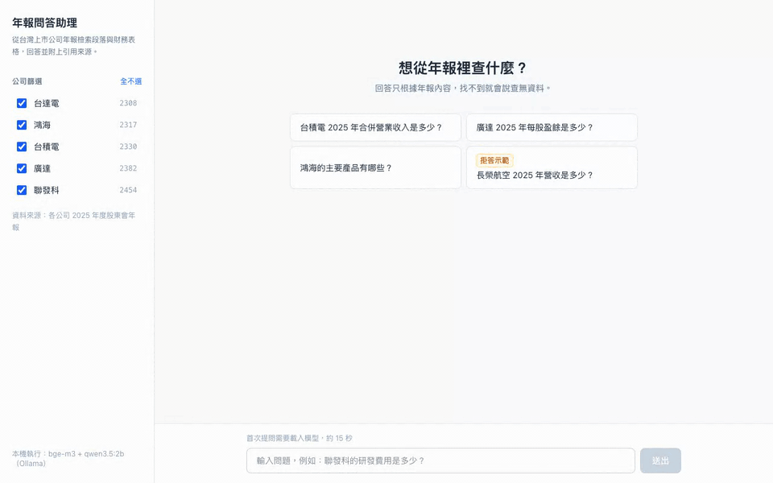
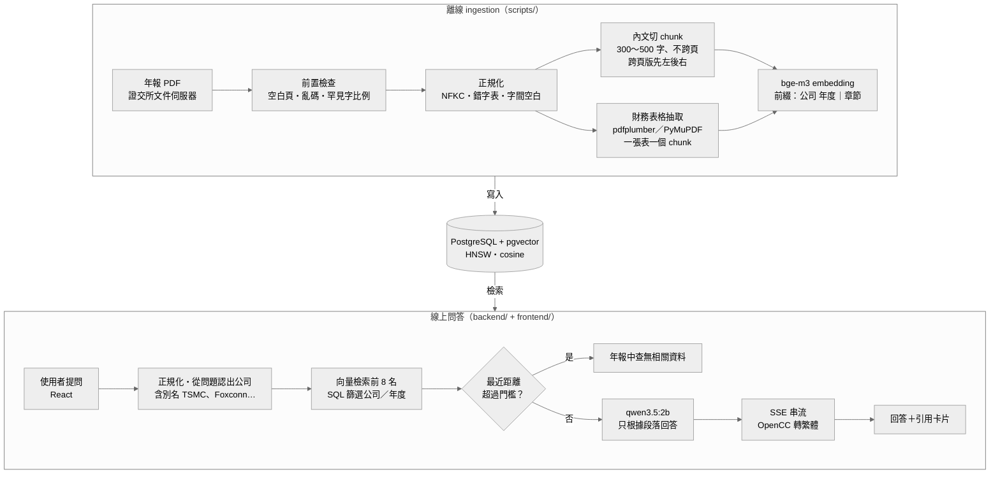

# twse-report-rag

[](https://github.com/kimi0217/twse-report-rag/actions/workflows/ci.yml)

**台灣上市公司年報 AI 問答助理。使用者用中文提問，系統從年報裡找出相關的段落和財務表格，交給語言模型整理成回答，並附上引用，點開即可看到原文。**

> A local RAG assistant that answers Chinese questions about Taiwanese companies' annual reports, with clickable citations to the source page.
> It runs entirely on your machine — Ollama (bge-m3 + qwen3.5:2b), PostgreSQL/pgvector and hand-written retrieval, no LangChain and no API keys — and starts with `docker compose up`.
> On a 26-question evaluation set, retrieval found the right page for all 22 answerable questions (hit@8 22/22), and answer accuracy rose from 69% to 81%; most remaining errors come from the small model misreading the retrieved text.



收錄 5 家公司的 2025 年度股東會年報，年報被切成 1,794 個 chunk，其中包含內文 1,779 個和財務表格 15 個。

## 功能簡介

- **引用可以點開驗證**：回答裡的 `[1]` 可以點，會捲動到對應的來源卡片，點開可以看完整原文。卡片上的公司和頁碼，由程式直接從資料庫取出，不讓模型自己寫，所以不會出現編造的頁碼。
- **財務表格結構**：財務表格一張表存成一個 chunk，不會切開，表格範圍內的文字不會再當成一般內文重複存一次，避免數字黏在一起誤導模型。年報裡有「合併報表」（整個集團）和「個體報表」（只有母公司），兩張表長得很像，程式會在表名前標明是哪一種，並寫上金額單位。
- **找不到就說找不到**：用兩層把關。第一層由程式判斷，問題跟年報內容差太遠，就直接回答「年報中查無相關資料」，不交給模型；第二層由模型判斷，通過第一層的問題，模型也被規定只能根據找到的段落回答，找不到就說查無資料。
- **本機**：所有動作都在自己的電腦上執行，沒有 API key 與費用；`docker compose up` 加上 10 MB 的資料庫 seed 就能使用。
- **數據**：準備了兩組題目。26 題用來改進系統，每改一個地方，就用同一組題目重新測一次，比較修改前後答對幾題；另外 6 題凍結的 held-out 驗收集在改進前就鎖定，只在最後驗收一次（見[評估結果](#評估結果)）。

## 架構



離線流程只跑一次，把資料寫進資料庫；線上服務只讀資料庫。

## 快速開始

使用 seed：一個預先處理好的資料庫檔案（約 10 MB），下載後啟動就會自動匯入，不需要自己處理 PDF，也不需要跑 ingestion。

### 需要先安裝

- **Docker**：[Docker Desktop](https://www.docker.com/products/docker-desktop/) 或 [OrbStack](https://orbstack.dev/)（Mac），裝好後要先開啟。
- **Ollama**：[ollama.com/download](https://ollama.com/download)，請用最新版（舊版下載不了 `qwen3.5:2b`）。Ollama 直接裝在主機上，不放進 Docker：Mac 的 Docker 用不到 GPU。

### 步驟

```bash
# 1. 下載模型（embedding 約 1.2 GB、LLM 約 3 GB）
ollama pull bge-m3
ollama pull qwen3.5:2b

# 2. 設定檔（預設值即可直接使用）
cp .env.example .env

# 3. 下載資料庫 seed（約 10 MB，會檢查 SHA-256）
sh scripts/fetch_seed.sh

# 4. 使用 docker compose 啟動
docker compose up -d --build
```

打開 <http://localhost:8080>，點範例問題或直接輸入問題。

第一次啟動需要 1～2 分鐘匯入資料；第一次提問需要約 15 秒載入模型。

## 評估結果

完整報告：[`eval/results.md`](eval/results.md)；題目與原文：[`eval/questions_review.md`](eval/questions_review.md)。

**評估集**：26 題，都從 PDF 原文出題，每題附原文證據。題型包括數字題 11 題、文字題 8 題、別名題 2 題（例如：「TSMC」、「Foxconn」）、拒答題 4 題、跨公司比較 1 題。開發時用過的 7 題標成 `seen`，另外列出只看沒用過的題目的分數。

**指標**：hit@k 指檢索到的（公司、頁碼）在正確答案頁裡。

### 逐步改進（主評估集 26 題）

| 版本 | hit@3 | hit@8 | MRR | 誤拒率 | 回答正確率 | unseen 回答正確率 |
|---|---|---|---|---|---|---|
| baseline（純向量檢索） | 91% | 100% | 0.78 | 23% | 69% | 63% |
| 問題提到已知公司時放寬拒答門檻 | 91% | 100% | 0.78 | 5% | 81% | 74% |
| 新增年度提示 + 段落依相似度排序 | 91% | 100% | 0.78 | 5% | 69% | 68% |
| 撤回年度提示 | 91% | 100% | 0.78 | 5% | 81% | 74% |
| 加上輸出長度上限 | 91% | 100% | 0.78 | 5% | 88% | 84% |

開發時用過的 7 題可能因為被調整過而答得比較好，所以另外列出排除它們之後的分數。

- 所有版本的拒答召回率都是 100%。
- **年度提示造成退步，已撤回**：在 prompt 寫明「去年指 2025 年」，修好 2 題，卻讓另外 4 題明確寫出「去年（即民國 113 年）」，讀成前一年度的欄位，正確率從 81% 掉到 69%。

### Held-out 驗收

| 項目 | 結果 |
|---|---|
| 檢索（3 題可回答） | hit@3 100%、hit@8 100% |
| 拒答（3 題提到已知公司，但年報裡沒有答案，例如「台積電明年股價」） | 3/3 正確拒答，都是 LLM 判斷的 |
| 回答正確率 | 自動判分 4/6，複檢後為 3/6 |

第一次驗收時，有一題的回答無限生成 21 分鐘，只好中止；加上輸出上限之後，重新跑了一次。

### 結論

**檢索已經達標**，22 題可回答題的正確答案頁全部都在前 8 名（hit@8 22/22），held-out 的 3 題也一樣（3/3）。**瓶頸在 2B 模型的閱讀理解**，主評估集和 held-out 的錯誤，大多是正確段落已經在 context 裡，模型卻讀錯欄位（「去年」讀成前一年度）、挑錯人名，或該回答時拒答。下一步最有效的是換更大的 LLM，或由程式先把「去年」換成明確年度，而不是繼續調整檢索。

## 遇到的問題與解法

詳細過程見 [`docs/pdf-preflight.md`](docs/pdf-preflight.md)、[`docs/known-issues.md`](docs/known-issues.md)。

1. **抽得出中文，但字是錯的**：中華電年報的字型有問題，抽出 17% 的錯字。新增「罕見字比例」檢查，自動判定 FAIL，換成廣達。
2. **表格被攤平成黏在一起的數字**：財務表格改成整張存成一段，並在表名標明合併或個體報表，並寫上金額單位。
3. **金額單位差 1,000 倍**：模型漏寫「仟」字。在表格開頭標明單位，並在 prompt 加上範例。
4. **拒答門檻誤拒可以回答的問題**：問題提到已知公司時放寬門檻，誤拒率從 23% 降到 5%。

## 已知限制

詳見 [`docs/known-issues.md`](docs/known-issues.md)，重點如下：

- 使用者問「去年」（指 2025 年）時，小模型常誤以為是 2024 年，讀到表格裡 2024 年那一欄，答出錯誤的數字。
- 評估題目只有 32 題，小幅差異不宜過度解讀。

## 資料來源

年報 PDF 來自[臺灣證券交易所](https://www.twse.com.tw/)文件伺服器（doc.twse.com.tw）與[公開資訊觀測站](https://mops.twse.com.tw/)，為各公司依法公開揭露的 2025 年度股東會年報，著作權屬於各公司。本專案只作為技術展示與學習用途：repo 裡不含 PDF；GitHub Release 的資料庫 seed 含有從年報抽出的文字與表格，用於重現問答結果。回答內容由 AI 產生，可能有誤，不構成投資建議，請以原始年報為準。
